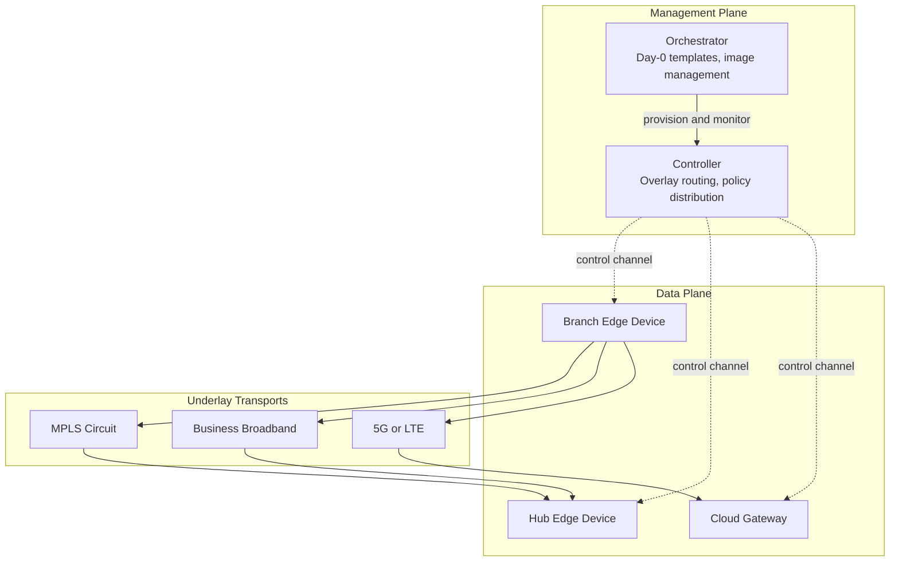
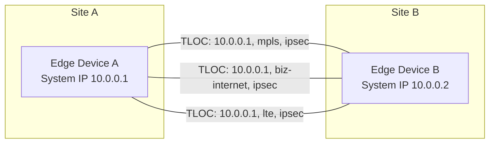
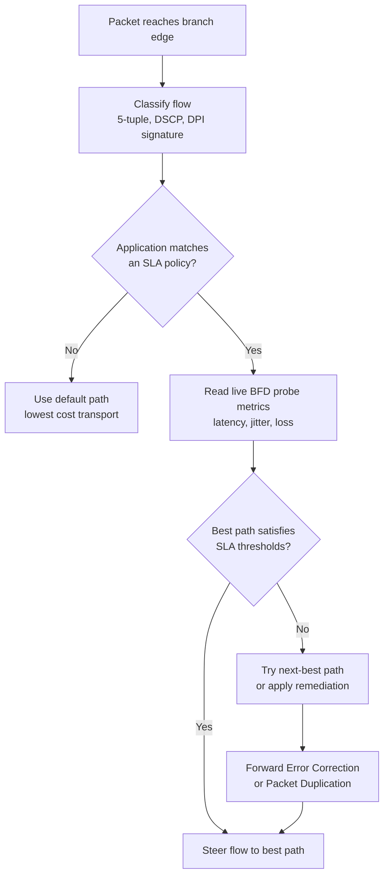
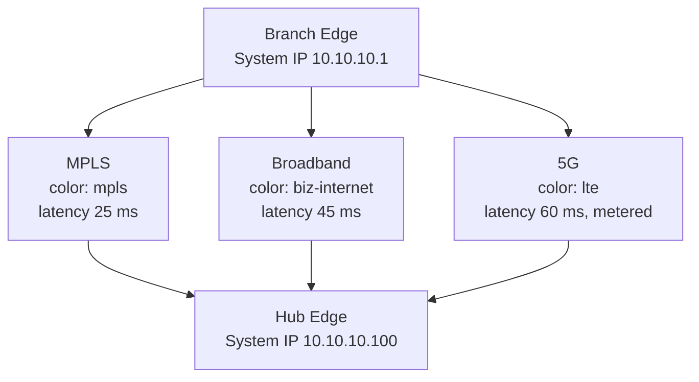

# SD-WAN

> [!info] One-Line Definition
> SD-WAN (Software-Defined Wide Area Network) is a WAN architecture that separates the control logic of a wide area network from its physical transport links, using a central controller and an encrypted overlay to steer application traffic across any mix of MPLS, broadband, and cellular circuits according to business policy rather than raw routing metrics.

## Overview

Traditional WAN design forced a tradeoff. You could buy expensive MPLS circuits with strong SLAs and no internet exposure, or you could buy cheap broadband with no guarantees at all. Most enterprises chose MPLS for every site because it was the only transport that could carry voice and business-critical traffic reliably.

That model broke when applications moved to the cloud. Branch traffic no longer flows to the data center and back. It flows sideways to Microsoft 365, Salesforce, Zoom, and a dozen SaaS tenants. Backhauling that traffic through an MPLS hub added latency for no benefit, and MPLS pricing is driven by bandwidth and distance, so scaling it up was painful.

SD-WAN answers with three moves. First, use any transport, including plain internet, and make the encrypted overlay the thing that provides consistency. Second, centralize policy so that "voice goes on the low-latency link" is written once and applied everywhere. Third, measure the links continuously and move traffic in real time when a link degrades.

> [!info] Where It Fits
> SD-WAN sits at the overlay layer. It does not replace IP, it does not replace BGP, and it does not replace your firewall. It wraps existing transports in tunnels and decides which tunnel each flow should use. In the modern stack it is often the delivery vehicle for SASE, where security inspection is chained into the same policy engine.

The market moved fast. MEF published formal SD-WAN service attributes in 2019 (MEF 70), and Gartner pushed the SASE convergence shortly after. By the mid 2020s, SD-WAN is close to a default enterprise branch design rather than a differentiator.

### SD-WAN Compared To Its Neighbors

| Concept | What It Controls | Relationship To SD-WAN |
|---|---|---|
| SDN | Data center and campus switching fabric | Same philosophy (central control, programmable data plane), different scope |
| SD-WAN | Branch and inter-site WAN transport | A specific application of SDN ideas to the WAN edge |
| SASE | Security inspection plus WAN delivery as one cloud service | SD-WAN is the networking half of SASE |
| SSE | Cloud-delivered security only (SWG, CASB, ZTNA) | The security half, usable without SD-WAN |
| MPLS VPN | A carrier-provided private transport | One possible underlay for SD-WAN, not a competitor |

## How It Works

SD-WAN works by running an encrypted overlay on top of whatever circuits you can buy, then letting a controller decide which overlay path each application should take. The underlay stays dumb; the intelligence lives in the overlay and the controller.

### The Three Planes



The management plane handles templates, software versions, and inventory. The controller distributes routes, encryption keys, and policy. The data plane is the actual packet forwarding at each edge device. Only the control and management channels touch the controller; user traffic never does, which is why losing the controller does not break forwarding.

### Overlay And Underlay

The **underlay** is the physical and logical transport: MPLS, DIA (direct internet access), LTE, 5G, satellite. Each underlay link terminates on a physical or logical interface at the edge device and gets assigned a **color** (for example `mpls`, `biz-internet`, `lte`, `public-internet`). The color is a label that policy can reference.

The **overlay** is a mesh of encrypted tunnels built between edge devices over those transports. Each tunnel is identified by a **TLOC** (Transport LOCator), which is the tuple of system IP, color, and encapsulation. A TLOC is roughly "this device, over this transport."



Because tunnels are point to point between TLOCs, a site with three transports talking to a site with two transports has six possible paths. The controller knows all of them and can shift traffic between them in under a second.

### Control Plane And Route Distribution

Proprietary controllers use their own overlay routing protocol. Cisco Catalyst SD-WAN uses **OMP** (Overlay Management Protocol), which is BGP-like in structure but carries more than routes: it also carries TLOC attributes, encryption keys, and policy. Other vendors use BGP with extended communities, or a controller API.

At the site boundary, the edge device speaks normal routing protocols to the LAN: OSPF, BGP, or static routes. It redistributes those into the overlay, then re-advertises them at the remote site. The branch router never needs to know the underlay topology.

> [!info] OMP Route Example
> An OMP route advertisement carries a prefix plus a TLOC list. The TLOC list is what gives the remote site multiple candidate paths for the same prefix. Path selection then filters that list by SLA.

### Application-Aware Routing And Path Selection

This is the core mechanism that separates SD-WAN from a plain VPN mesh.



Each edge device runs continuous **BFD** (Bidirectional Forwarding Detection) probes over every tunnel to every peer. Probes are tiny and frequent, typically every 100 ms to 1 second. From them the device derives per-tunnel latency, jitter, and packet loss.

An SLA class is a threshold triple, for example latency under 150 ms, jitter under 30 ms, loss under 1 percent. The device scores each tunnel against the class and picks the best compliant one. Flow classification happens on the first packet of a flow and the decision sticks for the life of the flow, so packets stay in order.

### Remediation Techniques

When no path meets the SLA, SD-WAN has several fallbacks that a traditional router cannot offer.

| Technique | What It Does | Cost |
|---|---|---|
| Forward Error Correction | Adds parity packets so the receiver can rebuild lost ones | Extra bandwidth, roughly 5 to 20 percent |
| Packet Duplication | Transmits the same packet on two tunnels, receiver keeps the first | Doubles bandwidth for that flow |
| TCP Optimization | Local acknowledgements, window scaling, proxy behavior | Adds state, can break end-to-end semantics |
| Deduplication and Compression | Removes repeated byte patterns before transmission | CPU on both sides, only helps repetitive traffic |
| Best-path reselection | Simply moves the flow to a better tunnel | Brief reordering risk on mid-flow switch |

### Zero Touch Provisioning

A branch device ships with no configuration. On power-up it reaches a PnP or bootstrap server, authenticates with a signed certificate or a serial-number-based token, pulls its template and policy from the controller, and comes online. The on-site person only needs to plug in cables and confirm the link lights.

This matters operationally because it removes the need for a skilled network engineer at every site. A 500-branch retailer can stage and ship devices directly from the vendor.

### Segmentation And Multi-Tenancy

SD-WAN devices support **VPN segmentation**, functionally the same as VRF in MPLS. You define separate logical topologies so that, for example, guest Wi-Fi, PCI card processing, and corporate traffic never share a routing table or a tunnel.

A common pattern is three segments: corporate (full mesh, all applications), guest (internet breakout only), and IoT or OT (hub-and-spoke to a single inspection point, no lateral movement).

### Security And The SASE Convergence

Overlay tunnels use IPsec with AES-256-GCM and rotate keys through the controller. That gives confidentiality and integrity on the wire but does nothing about malware, data exfiltration, or a compromised branch user.

This is why SD-WAN converged into SASE. Security functions get chained into the same policy: a flow can be steered to a cloud security PoP for SWG inspection, to a CASB for SaaS control, or to a ZTNA broker for private application access, all based on the same application identity that drives path selection.

## Key Details

This section collects the concrete properties, numbers, and standards you need to reason about a real design.

### The SLA Metrics That Drive Decisions

| Metric | Definition | Typical Threshold | Why It Matters |
|---|---|---|---|
| Latency (one-way) | Time for a packet to cross the path | 100 to 150 ms for voice | Above about 150 ms round trip, conversation feels broken |
| Jitter | Variation in latency between packets | Under 30 ms | Jitter drains the de-jitter buffer and causes dropouts |
| Packet loss | Percentage of packets never arriving | Under 1 percent | Loss above 2 percent destroys voice and video quality |
| MOS | Predicted voice quality score, 1.0 to 4.5 | 4.0 or better | Business-facing summary of the above three |
| Bandwidth | Available capacity | Per application need | Aggregation is possible but per-flow limited |
| MTU | Largest frame without fragmentation | 1500, or 1400 inside tunnels | Tunnel overhead eats into the usable MTU |

### Useful Formulas

The E-model estimates voice quality from transport metrics. For \(R\) in the range 0 to 100:

$$R = R_0 - I_s - I_d - I_{e,\text{eff}} + A$$

$$\text{MOS} = 1 + 0.035R + 7 \times 10^{-6}\, R (R - 60)(100 - R)$$

Where \(I_d\) is the impairment from delay and \(I_{e,\text{eff}}\) combines codec impairment with packet loss. MOS of 4.0 corresponds roughly to \(R = 80\).

Availability of two independent parallel transports is the complement of both being down at once:

$$A_{\text{total}} = 1 - (1 - A_1)(1 - A_2)$$

With MPLS at 99.99 percent and broadband at 99.9 percent, the combined figure is \(1 - (0.0001)(0.001) = 99.99999\%\). This is the arithmetic behind the "add a cheap second link" argument. The independence assumption is doing a lot of work there.

Tunnel overhead reduces usable MTU:

$$\text{MTU}_{\text{usable}} = \text{MTU}_{\text{underlay}} - \text{IPsec overhead} - \text{encapsulation overhead}$$

For IPsec with ESP in tunnel mode over IPv4, expect roughly 50 to 73 bytes of overhead depending on cipher and whether NAT-T or UDP encapsulation is used. This is why many designs set the tunnel MTU to 1400 or lower.

### Deployment Models

| Model | Controller Location | Who Operates It | Typical Buyer |
|---|---|---|---|
| On-premises | Customer data center | Customer | Regulated industries, banks, government |
| Cloud-hosted | Vendor or public cloud PoPs | Customer, vendor assists | Most mid and large enterprises |
| Fully managed | Vendor cloud | Service provider | SMBs, retail chains without network staff |
| Co-managed | Vendor cloud | Split by domain | Enterprises keeping policy, outsourcing break-fix |

### Standards And Specifications

- **MEF 70** defines SD-WAN service attributes and a service-level specification framework, giving buyers a common vocabulary when comparing offerings.
- **MEF 70.1** extends it with application flow performance and application-aware policy attributes.
- **ONUG** published early open SD-WAN frameworks that shaped the vendor vocabulary around overlays and controllers.
- **RFC 9293 / TCP** and **RFC 5880 / BFD** are the underlying standards that most implementations lean on for transport and liveness probing.
- **IPsec** remains defined by RFC 4301 and its successors, with IKEv2 (RFC 7296) for key exchange.

### Vendor Landscape

| Vendor | Product Name | Notable Trait |
|---|---|---|
| Cisco | Catalyst SD-WAN (formerly Viptela) | Deep OMP control plane, strong enterprise routing integration |
| Broadcom | VMware VeloCloud SD-WAN | Large managed-service footprint, gateway-based cloud on-ramp |
| Fortinet | FortiGate Secure SD-WAN | Firewall and SD-WAN on one appliance, popular in mid-market |
| Palo Alto Networks | Prisma SD-WAN (formerly CloudGenix) | App-defined fabric, tight Prisma Access integration |
| Versa | Versa Operating System | Strong multi-tenancy, favored by service providers |
| Juniper | Session Smart Router / AI-Driven SD-WAN | Session-based routing rather than tunnel-based |
| HPE Aruba | EdgeConnect (formerly Silver Peak) | Strong WAN optimization heritage, Boost for FEC |
| Huawei | SD-WAN Solution | Regional strength, tight carrier integration |

> [!warning] Interoperability Reality
> SD-WAN overlays are almost entirely proprietary. Two different vendors' edge devices will not form a common overlay mesh. A mixed-vendor estate usually requires either a gateway translation layer, a standards-based approach, or acceptance of separate fabric islands. MEF 70 standardizes the *service description*, not the wire protocol.

## Examples

Concrete configurations and calculations make the mechanisms easier to hold onto.

### Example 1: A Branch With Three Transports

Consider a branch with MPLS, fiber broadband, and 5G. Voice must always go on a link with latency under 150 ms and loss under 1 percent. Bulk backup traffic should use the cheapest link and tolerate anything.



Voice traffic matches the strict SLA class and lands on MPLS. Web and SaaS traffic matches a looser class, and the device sends it over broadband to keep the MPLS circuit under its committed rate. Backup jobs match a bulk class that prefers broadband and only uses 5G when the other two are down, because 5G is metered.

### Example 2: Cisco Catalyst SD-WAN SLA Policy

This is an illustrative vManage policy fragment. Field names vary between releases, and the real template is JSON, so treat this as a shape rather than a copy-paste artifact.

```yaml
policy:
  sla-classes:
    - name: VOICE_SLA
      latency: 150
      jitter: 30
      loss: 1
    - name: BULK_SLA
      latency: 1000
      jitter: 200
      loss: 10

  app-route-policy:
    - name: STEER_APPS
      sequences:
        - sequence-id: 10
          match:
            app-list: VOICE_VIDEO_APPS
          actions:
            sla-class: VOICE_SLA
            strict: true
            backup-sla-preferred-color: biz-internet
        - sequence-id: 20
          match:
            app-list: BACKUP_APPS
          actions:
            sla-class: BULK_SLA
            strict: false
      default-action:
        sla-class: VOICE_SLA
```

`strict: true` means do not use a non-compliant path at all, which is what you want for voice. `strict: false` means fall back to the best available path even if it misses the thresholds, which is what you want for bulk transfer.

### Example 3: BFD Tuning On The Tunnel Interface

```text
interface Tunnel100001
 description MPLS transport
 ip unnumbered GigabitEthernet0/0/0
 tunnel source GigabitEthernet0/0/0
 tunnel mode sdwan
 tunnel destination 192.0.2.10
!
bfd color mpls
 hello-interval 1000
 multiplier 6
 no shutdown
```

A 1000 ms hello with a multiplier of 6 declares the tunnel dead after about 6 seconds. Lowering the interval to 100 ms with a multiplier of 3 detects failure in 300 ms, at the cost of more probe traffic and more CPU. Below roughly 100 ms you start competing with real traffic on slow links.

### Example 4: Scoring Links In Python

A small model of how a controller or edge device ranks candidate paths.

```python
from dataclasses import dataclass


@dataclass
class Link:
    name: str
    latency_ms: float
    jitter_ms: float
    loss_pct: float
    cost_per_gb: float = 0.0


def sla_score(link: Link, lat_max=150.0, jit_max=30.0, loss_max=1.0) -> float:
    """Return 0.0 (unusable) to 1.0 (perfect) against a voice-like SLA class."""
    lat = max(0.0, 1.0 - link.latency_ms / lat_max)
    jit = max(0.0, 1.0 - link.jitter_ms / jit_max)
    loss = max(0.0, 1.0 - link.loss_pct / loss_max)
    return round((lat + jit + loss) / 3.0, 3)


def pick_path(links, min_score=0.6):
    viable = [(lst, l) for l in links for lst in [sla_score(l)] if lst >= min_score]
    if not viable:
        return None
    # Prefer the highest score; break ties with the cheapest link.
    return max(viable, key=lambda t: (t[0], -t[1].cost_per_gb))[1]


links = [
    Link("mpls", latency_ms=25, jitter_ms=3, loss_pct=0.05, cost_per_gb=1.20),
    Link("broadband", latency_ms=45, jitter_ms=12, loss_pct=0.40, cost_per_gb=0.09),
    Link("5g", latency_ms=60, jitter_ms=25, loss_pct=1.80, cost_per_gb=4.50),
]

for link in links:
    print(f"{link.name:10s} score={sla_score(link)}")

print("chosen:", pick_path(links))
```

```text
mpls       score=0.927
broadband  score=0.767
5g         score=0.553
chosen: Link(name='mpls', ...)
```

The 5G link scores 0.553 because its loss of 1.8 percent is above the 1 percent voice threshold, so it is filtered out entirely. It would still be a valid choice for a bulk class with a 10 percent loss ceiling.

### Example 5: Cost Comparison Sketch

A 200-branch retailer currently spends \$1,200 per month per site on a 50 Mbps MPLS circuit, so roughly \$2.88M per year. An SD-WAN design keeps MPLS at 20 Mbps for voice-critical sites only, adds a \$60 per month 500 Mbps broadband circuit everywhere, and adds a \$150 per month 5G backup at 40 critical sites.

```text
MPLS (40 critical sites x 20 Mbps x \$600/mo x 12)   = \$288,000
Broadband (200 sites x \$60/mo x 12)                = \$144,000
5G backup (40 sites x \$150/mo x 12)                = \$72,000
SD-WAN licensing (200 sites x \$40/mo x 12)         = \$96,000
--------------------------------------------------------------
Annual total                                        = \$600,000
Previous annual total                               = \$2,880,000
```

The bandwidth per site goes up by an order of magnitude and the cost drops by roughly 79 percent. The catch is that the broadband circuits have no SLA, which is exactly why the SLA probing and remediation machinery has to exist.

## Common Misconceptions

> [!warning] "SD-WAN Just Means Replacing MPLS With Cheap Internet"
> The transport swap is the visible part, not the mechanism. An SD-WAN built entirely on MPLS circuits is still SD-WAN, and a broadband-only mesh with static routes is not. The defining feature is policy-driven, measurement-driven path selection over an overlay, not which carrier you buy from.

> [!warning] "SD-WAN Replaces Your Firewall And Your Security Stack"
> Overlay encryption protects traffic in transit between edge devices. It does not inspect payloads, block malicious domains, or stop a compromised laptop from exfiltrating data over a tunnel. That is the SASE layer, and plenty of SD-WAN deployments add it as a separate step.

> [!warning] "The Controller Is A Single Point Of Failure"
> Controls are typically deployed as a redundant cluster, and forwarding continues if every controller goes down. Edge devices cache their routes, policies, and keys locally. You lose the ability to make changes, not the ability to pass traffic.

> [!warning] "A Second Link Automatically Doubles Reliability"
> Only if the two links are genuinely independent. Two circuits from the same carrier frequently share a duct, a conduit, and a PoP. A single backhoe outage takes both. Check the physical path diversity before trusting the availability arithmetic.

> [!warning] "SD-WAN Aggregates Bandwidth Into One Fat Pipe"
> Multiple links provide multiple paths, not one larger pipe. A single TCP flow is pinned to one tunnel to avoid reordering, so a 100 Mbps download will not use 50 Mbps of MPLS plus 50 Mbps of broadband simultaneously. Only many concurrent flows spread across links, and per-packet load balancing is usually avoided for exactly this reordering reason.

Additional points worth stating plainly:

- **DPI cannot classify encrypted traffic** beyond what is visible in TLS SNI, certificate fields, and connection metadata. Vendors that claim full application visibility on encrypted flows are usually inferring from metadata, which works well for common SaaS and poorly for custom internal apps.
- **SD-WAN is not SDN in the data center sense.** Centralized control is shared, but SD-WAN is tunnel-based and policy-based, while data center SDN is typically flow-table-based and fabric-oriented.
- **FEC is not free.** It consumes bandwidth on the very links that are already constrained, and on a clean link it is pure overhead.
- **Cloud on-ramp is a separate problem.** Reaching a public cloud region over an SD-WAN overlay is not automatic. You still need a virtual edge in the VPC, a colocation gateway, or a carrier's cloud connect product, and cloud providers charge for the ingress path.
- **Managed SD-WAN hides the mechanism.** If a provider runs the controller and the policy, you get the cost benefit and lose the tuning. Ask who owns the policy template before signing.

## Related Concepts

- [[广域网 WAN]] for the underlying transport landscape this architecture overlays on.
- [[MPLS]] for the private carrier transport that SD-WAN most often coexists with.
- [[BGP]] for the routing protocol that carries reachability at the overlay and underlay boundaries.
- [[IPsec]] for the tunnel encryption that makes an untrusted underlay usable.
- [[BFD]] for the liveness and quality probing that drives path selection.
- [[SASE]] for the security convergence that SD-WAN increasingly delivers.
- [[Zero Trust Network Access]] for the per-application access model that replaces flat branch trust.
- [[Software-Defined Networking]] for the broader control-plane separation idea.
- [[Overlay Networks]] for the general principle of virtual topology over physical topology.
- [[OSPF]] for the interior routing protocol commonly run inside branch LANs.
- [[Traffic Engineering]] for the older MPLS-TE approach to steering traffic around congestion.
- [[Zero Touch Provisioning]] for the automated bring-up that makes large branch rollouts practical.
- [[Cloud On-Ramp]] for the connectivity patterns between an enterprise WAN and public cloud regions.
- [[Network Segmentation]] for the VRF-like isolation model used to separate traffic classes on shared hardware.
- [[WAN Optimization]] for the compression, deduplication, and TCP acceleration techniques SD-WAN absorbed.