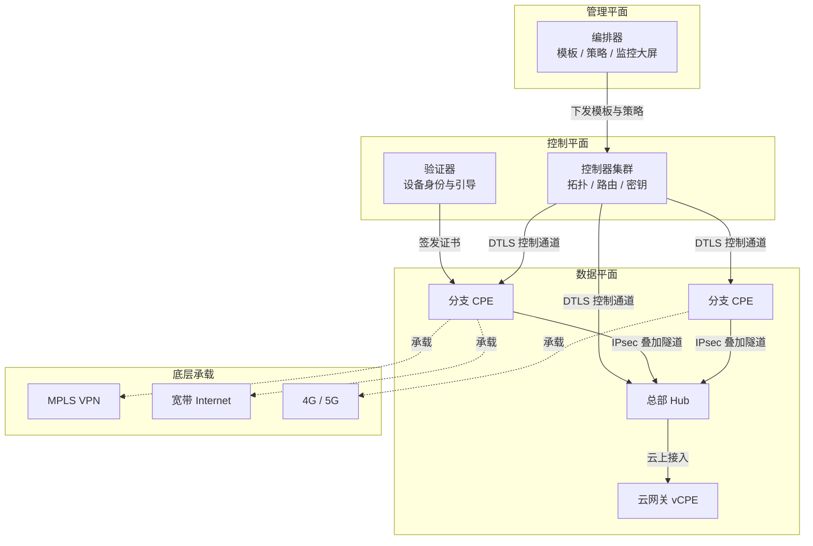
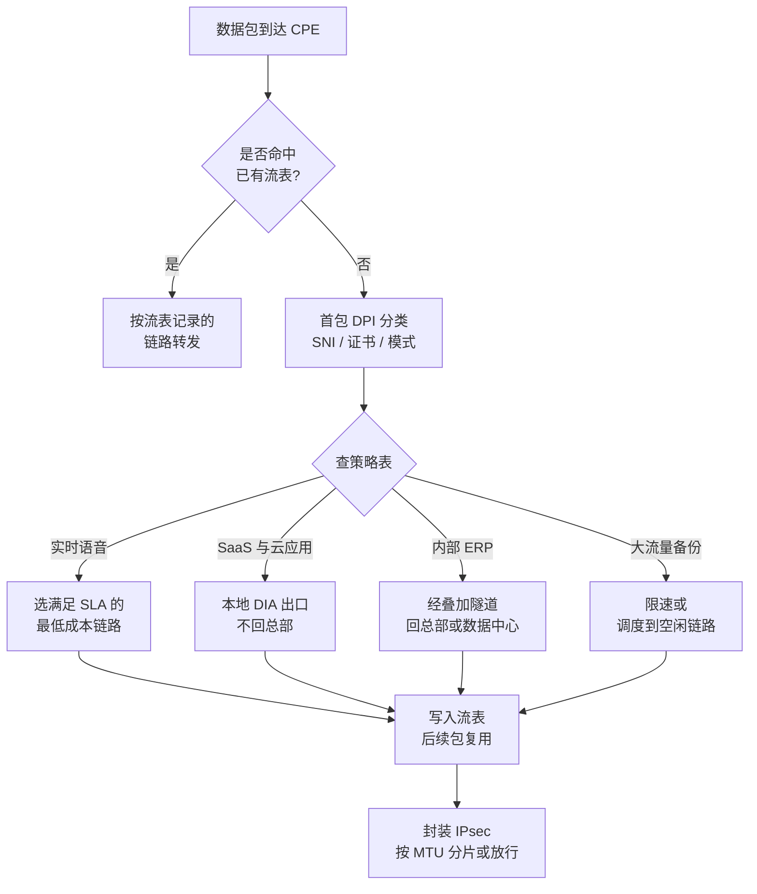
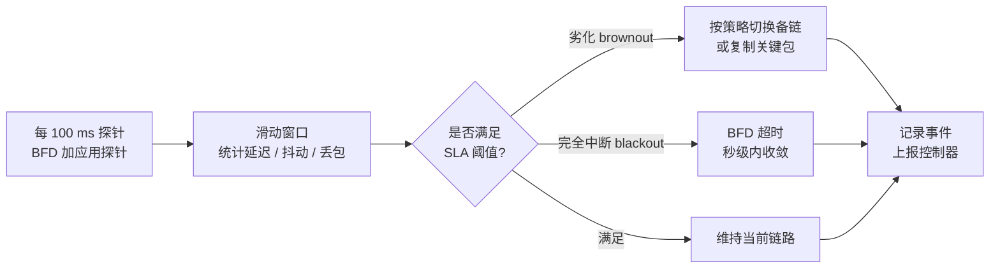

# SD-WAN 软件定义广域网

> [!info] 一句话定义
> SD-WAN (Software-Defined Wide Area Network) 是把广域网的**控制平面集中到软件控制器**、把**数据平面留在各站点的边缘设备**上的一种架构，让企业能用宽带、4G/5G 等多条廉价链路，通过叠加隧道 (overlay) 拼出一张策略驱动、应用感知的虚拟广域网。

## Overview

传统广域网的问题不在带宽，而在**僵化**。一条 MPLS 专线开通要等数周到数月，改一条路由要逐台设备登录，云应用的流量必须先绕回总部再出互联网，这一圈绕行在业内叫"长号效应" (tromboning)。

SD-WAN 的回答是把"选路"这件事从硬件和手工配置里抽出来，交给中央控制器按应用策略自动下发。链路本身仍然租用运营商的，但**怎么用这些链路**由企业自己决定。

它在 WAN 家族里的位置很特殊：MPLS VPN、专线、卫星链路是**承载 (underlay)**，SD-WAN 是跑在它们之上的**叠加 (overlay)**。两者不是替代关系，而是分层关系。

| 维度 | 传统 MPLS WAN | 传统 IPsec VPN | SD-WAN |
|---|---|---|---|
| 链路来源 | 运营商专线 | 任意互联网 | 任意，通常多链路混合 |
| 开通周期 | 数周到数月 | 数天 | 分钟级 (零接触开通) |
| 选路依据 | 目的地 IP | 目的地 IP | 应用 + SLA + 成本 |
| 配置方式 | 逐台 CLI | 逐台 CLI | 控制器模板集中下发 |
| 故障切换 | 路由收敛，秒到分钟 | 秒到分钟 | BFD 探针，亚秒到秒 |
| 云访问 | 回总部再出 | 回总部再出 | 本地直出 (DIA) |
| 月成本 (示意) | 100 Mbps 约 \$2,000 起 | 低 | 同带宽可降至十分之一 |
| 典型定位 | 关键业务兜底 | 小规模互联 | 主流企业广域网 |

> [!info] 与 SASE 的关系
> SD-WAN 解决"怎么连"，SASE (Secure Access Service Edge) 解决"连的同时怎么安全"。SASE = SD-WAN + 安全 Web 网关 (SWG) + 零信任网络访问 (ZTNA) + 云访问安全代理 (CASB) + 防火墙即服务 (FWaaS)，且安全能力部署在离用户近的云边缘。当前厂商普遍在把两者合并成一个产品。

## How It Works

理解 SD-WAN 要抓住一条主线：**控制与转发分离**。这是 SDN 的核心思想，SD-WAN 把它搬到了广域网场景。

### The Four Planes

SD-WAN 的架构通常拆成四层，每一层职责清晰。



- **管理平面**负责人机交互：建模板、定策略、看告警。改策略时只改这一层，不碰设备。
- **控制平面**是大脑，维护全网拓扑、计算路由、分发密钥。典型组件是控制器集群加一个负责设备引导和身份认证的验证器。
- **数据平面**是每个站点的一台 CPE (客户侧设备)，可以是物理盒子、虚拟机或容器。它建隧道、跑探针、按策略转发。
- **底层承载**就是运营商提供的各种链路，SD-WAN 把它们当成可替换的资源。

### Overlay Tunnels

每个站点对每一条底层链路建立一个隧道，通常成对出现：一条 MPLS 隧道、一条宽带上行隧道、一条 5G 隧道。

隧道技术以 IPsec ESP 为主，因为它标准、互通性好，并且用 UDP 封装可以穿越 NAT。

| 隧道技术 | 是否加密 | 典型用途 | 备注 |
|---|---|---|---|
| IPsec ESP | 是 | SD-WAN 主力 | 标准成熟，NAT 穿越靠 UDP 4500 封装 |
| GRE | 否 | 承载组播与动态路由协议 | 常与 IPsec 叠加成 GRE over IPsec |
| VXLAN | 否 | 云网关、数据中心互通 | 基于 UDP 4789，可再套 IPsec |
| WireGuard | 是 | 开源与 DIY 方案 | 代码精简、握手快，但无内置密钥分发 |
| DMVPN | 是 | 上一代动态多点 VPN | 依赖 NHRP，正被 SD-WAN 取代 |

隧道的标识在不同厂商有不同叫法。Cisco Catalyst SD-WAN 里叫 TLOC (Transport Locator)，由三个字段组成：`system-ip` + `color` + `encapsulation`。其中 `color` 是给链路起的语义化名字，比如 `mpls`、`biz-internet`、`lte`、`metro-ethernet`。策略就是按 color 来写"优先走哪个、坏了走哪个"。

### Routing and the Control Plane

叠加层的路由有两种做法。厂商私有方案用自有协议，例如 Cisco 的 OMP (Overlay Management Protocol)，它跑在 DTLS 或 TLS 之上，一条会话里同时传路由、TLOC、策略和密钥。开放方案则直接跑 BGP。

拓扑不一定要全互联。常见做法是总部与分支之间建永久隧道，分支与分支之间**按需建隧道**：先看控制器有没有对方的路由，有流量时再触发建立。

### Application-Aware Routing

这是 SD-WAN 最有价值的能力。它分四步。



1. **分类**：对流的第一个或前几个包做深度包检测 (DPI)，用 TLS 的 SNI、服务器证书字段、流量模式匹配来识别应用。识别结果写入流表，后续包直接复用，不再逐包检测。
2. **度量**：每条链路持续跑探针，通常是 BFD，间隔可以低到 100 毫秒到 1 秒，测出延迟、抖动、丢包率。
3. **决策**：拿应用类别去查策略，找出满足 SLA 阈值的链路集合，再按成本、优先级挑一条。
4. **执行**：把流绑定到选中的隧道。链路劣化时重新决策，必要时迁移流。

### SLA Probes and Failover

SD-WAN 把故障分成两类，处理方式不同。



- **Blackout (硬中断)**：链路彻底不通，BFD 在几百毫秒内超时，立刻切走。
- **Brownout (劣化)**：链路还通，但延迟从 20 ms 涨到 200 ms，或丢包从 0.1% 涨到 5%。这时 BFD 是通的，只有 SLA 探针能发现。这是 SD-WAN 相对传统方案的关键增量。

切换策略有三种强度：走备链、对关键包做复制 (同一条语音包在两条链路上各发一份，接收端去重)、以及开启前向纠错 FEC (额外发冗余包，接收端用冗余重建丢失的包)。FEC 会消耗带宽，通常按丢包率自适应开启。

### Zero Touch Provisioning

新站点上线不需要工程师到场。设备上电后自动发现控制器 (通过 DNS 记录或厂商的引导服务)，用出厂证书完成身份验证，然后从控制器拉取站点模板并应用。

这个流程的隐含前提是证书体系必须在部署前建好，否则设备无法自证身份。

### Underlay Independence and DIA

传统架构里所有分支流量都要回总部或数据中心再出去，叫回传 (backhaul)。SD-WAN 允许**本地互联网出口 (DIA)**：办公软件、视频会议这类 SaaS 流量直接从分支的宽带出去，不再绕行。

代价是安全边界被打散。分支的每个出口都变成了一个需要防护的边缘，这也是 SD-WAN 厂商必须往 SASE 演进的原因。

## Key Details

### MTU and Tunnel Overhead

隧道会吃掉载荷空间，这是部署中最容易踩的坑。以 IPv4 上的 IPsec ESP over UDP 为例：

$$
\text{Overhead} = 20_{\text{外层 IP}} + 8_{\text{UDP}} + 8_{\text{ESP 头}} + 8_{\text{IV}} + 16_{\text{ICV}} = 60 \text{ 字节}
$$

$$
\text{隧道内 MTU} = 1500 - 60 = 1440 \text{ 字节}
$$

如果底层是 PPPoE 拨号，还要再减 8 字节，变成 1432。实践中通常保守配置成 1400 甚至 1350，为多一层封装留余量。

> [!warning] MTU 黑洞
> 如果只调了隧道接口的 MTU，却没做 TCP MSS 钳制，会出现典型的"小包通、大包死"现象：ping 正常，网页打不开，TLS 握手卡在中间。原因是路径上的设备丢弃了需要分片的超大包，且没有回送 ICMP 需要分片的消息。务必同时配置 MSS 钳制。

$$
\text{MSS} = \text{MTU} - 40 \quad (\text{IPv4 的 20 字节 IP 头加 20 字节 TCP 头})
$$

排查命令示例：

```bash
# 逐字节试探路径最大可通包长（-M do 表示设置 DF 位，禁止分片）
ping -M do -s 1372 -c 3 10.200.0.1     # 1372 + 28 = 1400 字节的 IP 包

# 自动发现路径 MTU
tracepath 10.200.0.1

# 在转发路径上做 MSS 钳制
iptables -t mangle -A FORWARD -p tcp --tcp-flags SYN,RST SYN \
  -j TCPMSS --clamp-mss-to-pmtu
```

### Bandwidth Aggregation Is Partial

一个常见误解是"两条 100 Mbps 宽带拼起来就是 200 Mbps"。真实情况取决于流的粒度。

- **多流聚合有效**：100 个并发的 HTTP 下载可以分散到两条链路上，总吞吐接近 200 Mbps。
- **单流受限于单径**：一个 TCP 连接只能走一条路，上限就是那条路的带宽。逐包负载均衡理论上能突破，但会造成严重的乱序重传，反而拖慢 TCP。
- **UDP 流更容易聚合**，因为没有乱序重排的强约束，但业务层往往不允许。

### The Long Fat Pipe Problem

即使链路够宽，单个 TCP 流在长 RTT 下也跑不快，因为吞吐受窗口和 RTT 共同约束：

$$
\text{Throughput} \le \frac{\text{TCP Window}}{\text{RTT}}
$$

举例：RTT 为 100 ms，未开启窗口缩放的 TCP 窗口约 64 KB。

$$
\text{Throughput} \le \frac{65{,}536 \text{ B}}{0.1 \text{ s}} = 655{,}360 \text{ B/s} \approx 5.2 \text{ Mbps}
$$

也就是说，一条 1 Gbps 的链路，单个连接只能跑到 5 Mbps 上下。这就是 WAN 优化、窗口缩放和 QUIC 存在的意义。

### SLA Thresholds

阈值没有统一标准，由业务决定。下表是常见的参考区间。

| 应用类型    | 延迟       | 抖动      | 丢包     | 备注            |
| ------- | -------- | ------- | ------ | ------------- |
| 实时语音    | < 150 ms | < 30 ms | < 1%   | 超过后 MOS 分明显下降 |
| 视频会议    | < 200 ms | < 50 ms | < 2%   | 可容忍少量丢包       |
| 交互式终端   | < 100 ms | 不敏感     | < 0.5% | 对延迟最敏感        |
| 事务型 ERP | < 300 ms | 不敏感     | < 1%   | 可容忍抖动         |
| 批量备份    | 不限       | 不限      | < 5%   | 只关心成本         |

语音质量可以进一步用 ITU-T G.107 的 E 模型量化，最终映射成 1 到 5 的 MOS 分。工程上不必手算，直接用厂商的探针输出即可，但知道"丢包和抖动最终会折算成一个主观分数"这个链路是有用的。

### Availability Arithmetic

可用性用无量纲的方式定义：

$$
A = \frac{\text{MTBF}}{\text{MTBF} + \text{MTTR}}
$$

| 可用性 | 年停机时间 | 常见对应 |
|---|---|---|
| 99% | 3.65 天 | 单条家庭宽带 |
| 99.9% | 8.76 小时 | 典型企业宽带 |
| 99.99% | 52.6 分钟 | 优质专线 |
| 99.999% | 5.26 分钟 | 运营商骨干级 |

两条链路的联合可用性在**故障独立**假设下是：

$$
A_{\text{total}} = 1 - (1 - A_1)(1 - A_2)
$$

两条 99.9% 的链路算出来是 99.9999%，看起来很美。但这个公式的前提是故障独立，而现实中两条链路常常同沟同缆、同一个 ISP、同一路市电。

> [!warning] 独立性是假设，不是事实
> 施工挖断一根主干光缆同时打掉"两条"链路，是分支机构最常见的整站离线原因。做冗余设计时要问三个问题：物理路径是否分离、上游 ISP 是否不同、机房供电是否独立。

### Segmentation and Key Management

SD-WAN 通常支持把一张物理网络切成多个逻辑分段 (VPN 段或 VRF)，用于隔离访客 Wi-Fi、收银终端、物联网设备等。分段之间默认互不可见，需要策略显式放行。

加密方面，控制器充当密钥分发中心：为每个站点生成密钥对，通过控制通道下发，并支持定期轮换 (rekey)。这个设计让站点之间不必手工交换密钥，但也让控制器成为高价值攻击目标。

### Deployment Models

| 模式 | 谁运维控制器 | 谁运维边缘 | 适用场景 |
|---|---|---|---|
| DIY | 企业 | 企业 | 有强网络团队，追求完全控制 |
| 全托管 | 服务商 | 服务商 | 无网络团队，买服务不买设备 |
| 共管 | 服务商 | 企业 | 策略自己定，设备对方管 |

### Standards and Ecosystem

MEF 70 是 SD-WAN 的服务属性标准，定义了 SD-WAN 虚拟连接 (SWVC)、应用流、策略等术语，让不同运营商的服务可以横向比较。它只管服务属性，不管实现细节，所以不能指望它保证厂商之间的互操作。

开源和 DIY 生态里可用的组件包括 flexiWAN、VyOS、OpenWrt 的 mwan3、OPNsense 的多 WAN 支持，以及 FRR、VPP/DPDK 这类数据平面工具。

主流商业厂商包括 Cisco Catalyst SD-WAN、Fortinet、Palo Alto Prisma SD-WAN、HPE Aruba EdgeConnect、Versa、Juniper Mist、Cato Networks 等。

## Examples

### Example 1: A Vendor-Neutral Policy

策略的本质是"什么应用、什么条件下、走哪条路"。

```yaml
# 应用感知策略（厂商中立的示意写法）
policies:
  - name: realtime-voice
    match:
      app: [teams-audio, zoom-rtp, sip]
    path:
      preferred: [mpls, 5g]
      sla:
        latency_ms: 150
        jitter_ms: 30
        loss_pct: 1.0
    action:
      fec: adaptive
      duplication: on_brownout
      fallback: best_available

  - name: saas-breakout
    match:
      app: [m365, salesforce, zoom-video]
    path:
      preferred: [broadband]
      egress: local_dia
    action:
      tls_inspection: false
      log_flows: true

  - name: bulk-backup
    match:
      app: [smb, s3, backup-agent]
    path:
      preferred: [broadband, mpls]
      schedule: "22:00-06:00"
    action:
      rate_limit_mbps: 50
```

### Example 2: Cisco Catalyst SD-WAN Snippet

厂商设备的配置通常也是声明式的，由控制器下发到各站点。

```
sla-class VOICE-SLA
 latency 150
 jitter 30
 loss 1
!
app-list VOICE-APPS
 app ms-teams-audio
 app zoom-rtp
 app sip
!
policy
 app-route-policy VOICE-POLICY
  sequence 10
   match
    app-list VOICE-APPS
   action
    sla-class VOICE-SLA strict
    backup-sla-preferred-color mpls
   !
  !
 !
!
bfd color mpls
 hello-interval 300
 multiplier 3
!
omp
 graceful-restart
 send-path-limit 4
!
```

### Example 3: A Minimal DIY Overlay on Linux

用 WireGuard 加策略路由，可以在 Linux 上搭出一个功能极简但结构完整的 SD-WAN 叠加层。

```bash
# 1. 让每条隧道的底层出口明确分开（示例 IP 取自 RFC 5737 文档专用段）
ip route add 203.0.113.10/32 dev eth0      # Hub 的 MPLS 侧地址，走专线口
ip route add 198.51.100.7/32 dev wwan0     # Hub 的互联网侧地址，走 5G 口

# 2. 每条隧道的加密包打上 fwmark，各自走独立路由表
wg set wg-mpls fwmark 0x1
wg set wg-inet fwmark 0x2
ip rule add fwmark 0x1 lookup 100
ip rule add fwmark 0x2 lookup 200
ip route add default dev eth0 table 100
ip route add default dev wwan0 table 200

# 3. 业务流量按策略选隧道
nft add table inet sdwan
nft add chain inet sdwan prerouting '{ type filter hook prerouting priority mangle; }'
nft add rule inet sdwan prerouting ip daddr 10.10.5.0/24 meta mark set 0x1   # 语音网段优先走专线
nft add rule inet sdwan prerouting udp dport 443 meta mark set 0x2           # QUIC 流量走宽带
```

```ini
# /etc/wireguard/wg-mpls.conf
[Interface]
PrivateKey = <站点私钥>
Address    = 10.200.10.2/32
MTU        = 1380
Table      = off
FwMark     = 0x1

[Peer]
PublicKey  = <Hub 公钥>
AllowedIPs = 10.200.0.0/16
Endpoint   = hub-mpls.example.com:51820
PersistentKeepalive = 25
```

### Example 4: A Probe and Failover Loop

真实产品用 BFD 加硬件加速，但探测和切换的骨架是一样的。

> [!tip]- 点击展开：极简双链路探测脚本
>
> ```bash
> #!/usr/bin/env bash
> # 示意用的双链路健康探测与切换（生产环境请用 BFD 或厂商方案）
> set -u
>
> PRIMARY_IF=eth0        # 主链路
> BACKUP_IF=wwan0        # 备链路
> PROBE_TARGET=1.1.1.1
> MAX_FAIL=2             # 连续失败次数阈值
> STATE_FILE=/run/sdwan_active_path
>
> probe() {
>   ping -c 1 -W 1 -I "$1" "$PROBE_TARGET" >/dev/null 2>&1
> }
>
> fail=0
> while true; do
>   if probe "$PRIMARY_IF"; then
>     fail=0
>     echo "$PRIMARY_IF" > "$STATE_FILE"
>   else
>     fail=$((fail + 1))
>     if [ "$fail" -ge "$MAX_FAIL" ]; then
>       echo "$BACKUP_IF" > "$STATE_FILE"
>       ip route replace default dev "$BACKUP_IF" metric 100
>     fi
>   fi
>   sleep 2
> done
> 
> ```
>
> 这个脚本只探测可达性，不测延迟、抖动、丢包，所以它对付不了 brownout。真实产品会把探针结果做成滑动窗口，并用连续多个窗口的统计量做判决，避免因单个包抖动来回切换。

### Example 5: Sizing a Voice Path

假设某分支的语音流量是 20 路 G.729 通话，每路约 30 kbps。

$$
20 \times 30 \text{ kbps} = 600 \text{ kbps}
$$

若开启包复制，占用翻倍到 1.2 Mbps。若同时开启自适应 FEC，在 5% 丢包下典型冗余率约 30%，再加 0.18 Mbps。总共约 1.4 Mbps。

这个量级在任意一条链路上都微不足道，所以语音策略的正确写法不是"省带宽"，而是"宁可复制，不可劣化"。

## Common Misconceptions

- **"SD-WAN 就是 IPsec VPN 的升级版"**：不对。VPN 只提供加密隧道，SD-WAN 提供的是集中控制、应用感知、SLA 选路和自动化编排。IPsec 只是它常用的一种隧道实现。

- **"上了 SD-WAN 就能把 MPLS 退掉"**：多数企业是混合而非替代。关键业务、合规要求强的流量仍会保留在专线上，SD-WAN 的价值恰恰在于让"哪条流量走哪条链路"变成一个可以随时调整的策略。

- **"多条宽带加起来带宽翻倍"**：只在多流场景下成立。单条 TCP 连接仍受限于它所走的那一条路径。

- **"SD-WAN 能让网络变快"**：叠加层改变不了物理定律。它只能在既有链路之间做选择、复制和纠错，不能创造不存在的带宽或降低光速决定的传播延迟。

- **"控制器挂了全网就瘫了"**：不会。控制平面与数据平面分离的设计目标之一，就是控制器不可达时边缘设备继续用最后已知的策略转发。受影响的是新策略无法下发和新站点无法上线。

- **"SD-WAN 自带的加密就等于安全"**：加密解决的是传输机密性，不解决恶意软件、钓鱼、数据外泄。分支本地出口一旦打开，攻击面反而扩大，这正是 SASE 出现的原因。

- **"所有流量都该走本地互联网出口"**：DIA 适合 SaaS 和云应用。内部 ERP、数据中心访问走本地出口反而更慢或直接被拒绝，因为缺少内网路径。

- **"首包分类总是准的"**：加密流量、私有协议、端口跳变都会让 DPI 失手。成熟的实现会结合 SNI、证书、IP 信誉和行为特征，并在分类不确定时退回到保守策略。

- **"SD-WAN 控制器可以随时替换厂商"**：控制器和边缘设备是紧耦合的，叠加层协议多为私有，换厂商基本等于重建整张网络。

> [!warning] 迁移期的典型事故
> 从传统 WAN 迁移到 SD-WAN 时，如果新旧路径并存且没有做非对称路由检查，很容易出现"去程走新隧道、回程走老专线"的情况。状态防火墙会静默丢弃这类回包，表现为间歇性连接失败，排查起来非常费时。上线前务必逐个站点验证往返路径对称性。

## Related Concepts

- [[广域网 WAN]]：SD-WAN 是广域网的一种实现方式，理解承载与叠加的分层关系是起点。
- [[MPLS]]：传统企业广域网的主力技术，也是 SD-WAN 最常与之并存的底层链路。
- [[SDN]]：控制与转发分离的思想源头，SD-WAN 是它在广域网场景的具体落地。
- [[Overlay 网络与隧道]]：VXLAN、GRE、IPsec 等封装技术的通用原理。
- [[IPsec]]：SD-WAN 叠加隧道最常用的加密协议，涉及 IKE、ESP、NAT 穿越等细节。
- [[BGP]]：开放方案里承载叠加路由的常用协议，也是与运营商互联的基础。
- [[BFD]]：双向转发检测，SD-WAN 探测链路故障与质量的核心工具。
- [[SASE]]：SD-WAN 与云安全能力的融合形态，理解当代网络架构绕不开。
- [[零信任网络 ZTNA]]：以身份而非网络位置决定访问权限，与 SASE 常一起出现。
- [[服务质量 QoS]]：延迟、抖动、丢包如何影响业务，以及如何用队列和标记缓解。
- [[云连接 Cloud On-Ramp]]：AWS Transit Gateway、Azure Virtual WAN 等把企业网接入云的方式。
- [[网络功能虚拟化 NFV]]：让 CPE 从专用硬件变成虚拟机的底层技术。
- [[Segment Routing]]：运营商侧的现代流量工程方案，与 SD-WAN 属于不同层面的选路技术。
- [[长肥管道问题]]：高带宽高时延链路上 TCP 吞吐受限的根本原因。