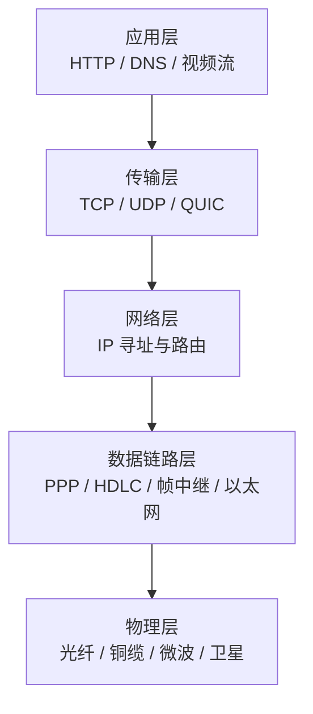
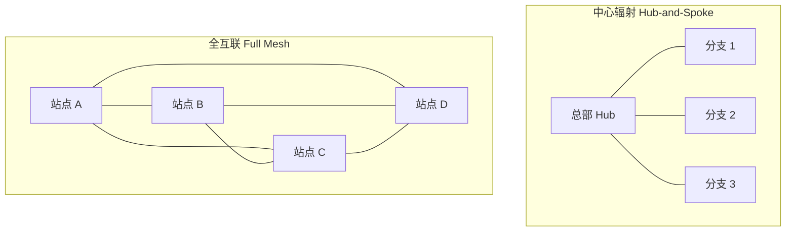
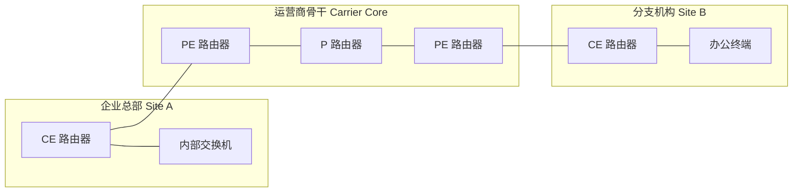
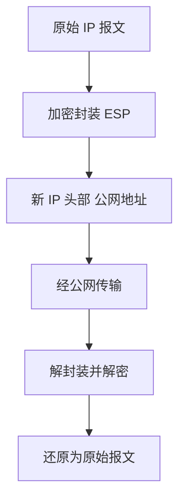
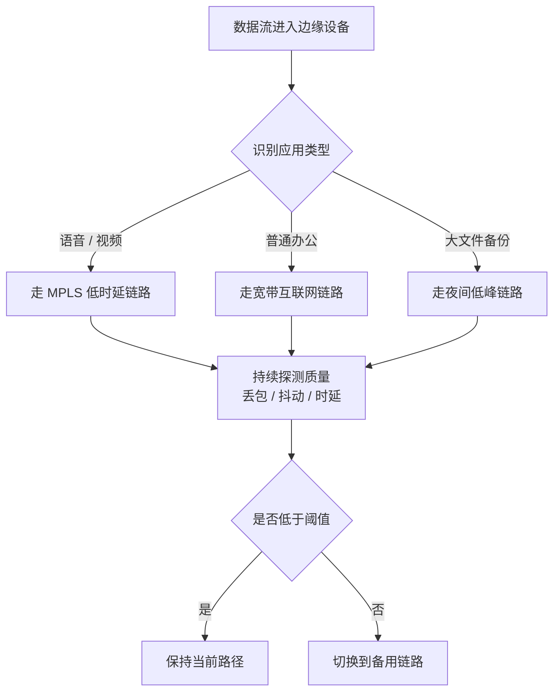

# 广域网 WAN

> [!info] 一句话定义
> 广域网 (Wide Area Network, WAN) 是跨越城市、国家乃至全球范围的计算机网络，它通过租用运营商的传输链路或公共网络，把地理上分散的多个局域网连接成一个逻辑上统一的网络。

## Overview

广域网的核心特征是**地理跨度大**和**链路不属于自己**。一个公司内部的交换机、网线、无线接入点通常是自建的，而连接北京总部和法兰克福分公司的光纤，几乎一定是向电信运营商租来的。

这带来一个根本差异：局域网里你可以随时换网线、改配置；广域网里你只能看到运营商给你的一个接口，中间的传输细节是一个黑盒。你买到的是一份**服务等级协议 (SLA)**，而不是一段物理线路。

在中文技术语境里需要区分两个词。教科书上的「广域网」是技术分类，包含专线、MPLS VPN、卫星链路等私有广域连接。日常运维口语里的「外网」通常指通往互联网的那一侧出口，与「内网」相对。两者高度重叠但并不等价：一条不接入互联网的银行跨省专线属于广域网，却不属于「外网」。

广域网的位置可以用覆盖范围来定位：

| 类型 | 全称 | 典型范围 | 所有权 | 例子 |
|---|---|---|---|---|
| PAN | 个人域网 | 10 米内 | 个人 | 蓝牙耳机、智能手表 |
| LAN | 局域网 | 一栋楼或一个园区 | 自建 | 办公室以太网、家庭 Wi-Fi |
| MAN | 城域网 | 一座城市 | 多为运营商 | 城市光纤环网、有线电视网 |
| WAN | 广域网 | 跨城市到全球 | 租用为主 | 企业专线、MPLS VPN |
| Internet | 互联网 | 全球 | 无数方共同拥有 | 公共 IP 网络 |

界限并非绝对。云时代之后，企业分支直接通过普通宽带接入云端应用，广域网与互联网的边界正在变得模糊。

## How It Works

理解广域网要从三个视角切入：数据怎么分层封装、物理信号怎么走、路由器之间怎么找到对方。

### 分层视角

广域网并没有创造新的协议栈，它只是把每一层换成了适合长距离传输的版本。



网络层及以上的协议在局域网和广域网里基本一致。真正替换掉的是下面两层：局域网用无连接的以太网帧，传统广域网则用面向连接的 PPP、帧中继或 ATM，因为早期长距离链路的误码率更高，需要链路层自己做重传和校验。

### 物理承载

洲际流量约 99% 走海底光缆。这些光缆由多国财团共同投资铺设，单条系统容量可达每秒数百 Tbps，采用波分复用 (WDM) 在一根光纤里同时传输上百个不同波长的光信号。

单根光纤断裂就能让一个国家的国际出口带宽骤降，这也是海底光缆被锚链或地震破坏时新闻会报道的原因。卫星链路 (GEO 约 36,000 公里高空) 因单程传播时延高达约 120 毫秒，一般只做备份。低轨星座 (如 Starlink) 把时延压到 20 到 50 毫秒，正在改变这个格局。

### 拓扑结构

广域网的拓扑决定了成本和可靠性之间的取舍。



中心辐射结构链路数量少、成本低，但总部一旦故障全体分支失联，且分支之间的流量要绕行总部。全互联冗余最好，链路数量却按站点数的平方增长，只有极少数核心站点会采用。实践中常用部分互联或动态多点 VPN (DMVPN) 在逻辑上模拟全互联，而物理上只保留少量链路。

### 运营商的角色

企业广域网通常是这样连起来的：企业侧的路由器叫 CE (Customer Edge)，运营商侧的路由器叫 PE (Provider Edge)，中间的骨干叫 P 路由器 (Provider)。



对企业来说，只有 CE 是可管理的。PE 之上的一切都是运营商的责任范围，这也解释了为什么广域网故障排查的第一件事永远是「确认是不是运营商侧的问题」。

### 隧道与 VPN

公共互联网不安全也不可靠，因此广域网大量使用隧道技术，把私有报文包裹在公网可路由的报文里传输。



常见的隧道技术差别很大。GRE 只是封装，不加密。IPsec 加密但不擅长组播和动态路由。DMVPN 把二者结合，用 mGRE 加 NHRP 实现分支间动态建隧道。SSL VPN 面向单个用户而不是站点。

需要强调：MPLS VPN 是运营商在骨干内部用标签实现的逻辑隔离，默认**不加密**。

### SD-WAN

传统广域网依赖昂贵的 MPLS 专线，配置僵化，改一条策略要等运营商排期数周。SD-WAN 把控制平面从硬件里抽出来，用集中控制器统一下发策略，并允许混合使用 MPLS、宽带、4G/5G 多种链路。



关键机制是**基于应用的路径选择**和**持续链路探测**。探针每秒都在测量每条链路的丢包、抖动和时延，一旦质量跌破阈值就自动切换，切换过程对上层应用透明。

## Key Details

这一节列出工程实践中必须记住的数值、公式和概念。

### 时延构成

总时延由四部分相加，只有一项和带宽有关。

$$d_{\text{total}} = d_{\text{proc}} + d_{\text{queue}} + d_{\text{trans}} + d_{\text{prop}}$$

- 处理时延 $d_{\text{proc}}$：路由器查表转发的时间，通常微秒级，可忽略。
- 排队时延 $d_{\text{queue}}$：接口拥塞时在缓冲区等待的时间，是抖动的主要来源。
- 传输时延 $d_{\text{trans}} = L / R$：把整个报文推上链路的时间，其中 $L$ 是报文长度，$R$ 是带宽。这是唯一随带宽改善的一项。
- 传播时延 $d_{\text{prop}} = d / v$：信号在介质中跑完距离的时间，其中 $v$ 是传播速度。

光纤中的光速约为 $2 \times 10^8$ m/s，大约是真空光速的三分之二。换算下来，**每 1 毫秒对应约 200 公里单程距离**。

这意味着上海到洛杉矶 (海缆实际路径约 13,000 公里) 的单程传播时延至少 65 毫秒，往返约 130 毫秒。实测通常在 140 到 180 毫秒。无论你买多大的带宽，这个数字都降不下来。

> [!warning] 常见误区
> 加带宽只能减少传输时延和排队时延。传播时延由光速和地理距离决定，是完全不可压缩的物理下限。

### 带宽时延积

带宽时延积 (Bandwidth-Delay Product, BDP) 指的是「管道里最多能装多少数据」。

$$BDP = 带宽 \times RTT$$

它决定了 TCP 需要多大的发送窗口才能跑满链路。如果窗口小于 BDP，发送方就会停下来等确认，链路利用率上不去。

| 带宽 | RTT | BDP | 需要的最小窗口 |
|---|---|---|---|
| 100 Mbps | 10 ms | 1 Mbit | 125 KB |
| 1 Gbps | 100 ms | 100 Mbit | 12.5 MB |
| 10 Gbps | 200 ms | 2 Gbit | 250 MB |

现代操作系统默认开启窗口缩放 (RFC 7323)，最大窗口可达 1 GB 量级。但在高 BDP 链路上，默认的 TCP CUBIC 拥塞控制仍然容易把丢包误判为拥塞并大幅降速。这也是 BBR 等基于带宽时延积测量的算法在跨洲链路上表现更好的原因。

### 电路类型

| 类型 | 机制 | 带宽保证 | 典型技术 |
|---|---|---|---|
| 专线电路 | 独占一条物理或逻辑通道 | 严格保证 | T1/E1、STM-N、OTN |
| 分组交换 | 数据切成分组共享网络 | 统计复用，可承诺 | 帧中继、X.25、IP |
| 信元交换 | 固定 53 字节信元 | 可做精细 QoS | ATM |
| 标签交换 | 用短标签代替 IP 查表 | 可做流量工程 | MPLS |
| 光交换 | 按波长分配 | 独占波长 | DWDM、OTN |

专用电路 (租用线) 的月租可以高达数万元，因为它把整条通道的容量锁给你。分组交换便宜得多，代价是高峰期会和其他用户抢带宽。

### 服务质量与 SLA

广域网服务合同里会写清楚这些指标，超出即触发赔付：

- 可用性：常见承诺 99.9% (年 downtime 约 8.8 小时) 到 99.99% (约 52 分钟)。
- 时延：通常承诺平均值和 95 分位值两个数字。
- 抖动：语音要求小于 30 毫秒，否则听起来会断续。
- 丢包率：一般承诺低于 0.1%，视频会议对丢包尤其敏感。

QoS 通过 DiffServ 的 DSCP 字段实现，常见的做法是给语音打 EF ( Expedited Forwarding, DSCP 46)，给视频打 AF41，普通数据打 0。逐跳的队列调度保证高优先级队列先出。

### BGP 与互联网互联

互联网是「网络的网络」，把无数个自治系统 (Autonomous System, AS) 连起来靠的是边界网关协议 (BGP)。

运营商之间的互联有两种模式。**传输 (Transit)** 是付费让上游帮你转发到整个互联网。**对等 (Peering)** 是两家运营商免费互换各自用户和自有网络的流量。大量运营商在互联网交换中心 (IXP) 里用一根光纤互联，节省成本。

互联网路由表在 2024 年已超过 95 万条 IPv4 前缀。任何一条路由抖动都可能在全球范围内传播，这也是 BGP 劫持事件频发的技术根源。

### MTU 与 MSS

广域网上最隐蔽的一类故障来自 MTU 不匹配。以太网标准 MTU 是 1500 字节，但 PPPoE 会占用 8 字节，各种隧道还会再剥掉 20 到 80 字节。

结果是路径 MTU 变小，而 ICMP 的「需要分片」报文又被很多防火墙丢弃，于是小包正常、大包卡死。典型症状是网页能打开但传不了文件、HTTPS 握手成功但传输中断。

解决方案是配置 MSS 钳制 (MSS Clamping)，让路由器主动把 TCP SYN 里的 MSS 值改小，避免依赖 ICMP 反馈。

## Examples

下面都是可以直接对照实践的例子。

### 计算带宽时延积

```python
def bandwidth_delay_product(bandwidth_gbps: float, rtt_ms: float) -> dict:
    """计算链路的带宽时延积，即管道中最多能容纳多少数据。"""
    bandwidth_bps = bandwidth_gbps * 1e9
    rtt_seconds = rtt_ms / 1000
    bits = bandwidth_bps * rtt_seconds
    return {
        "bits": bits,
        "kilobytes": bits / 8 / 1e3,
        "megabytes": bits / 8 / 1e6,
    }

print(bandwidth_delay_product(1.0, 100))
# {'bits': 100000000.0, 'kilobytes': 12500.0, 'megabytes': 12.5}
```

计算表明，一条 1 Gbps、往返 100 毫秒的链路，任何时刻「在路上」的数据可达 12.5 MB。如果 TCP 窗口只有 64 KB，理论吞吐上限只能达到：

$$\text{吞吐} = \frac{\text{窗口}}{RTT} = \frac{64 \times 8\ \text{Kbit}}{0.1\ \text{s}} = 5.12\ \text{Mbps}$$

也就是说，1 Gbps 的链路实际只用了不到 1%。这就是「带宽大但下载慢」最常见的技术原因。

### 解读 traceroute 输出

```
traceroute to 8.8.8.8 (8.8.8.8), 30 hops max, 60 byte packets
 1  192.168.1.1      1.203 ms   1.155 ms   1.101 ms
 2  100.64.0.1       8.442 ms   9.011 ms   8.776 ms
 3  10.20.0.1       12.334 ms  11.998 ms  12.551 ms
 4  202.97.12.34    25.667 ms  24.981 ms  25.113 ms
 5  8.8.8.8         45.221 ms  44.877 ms  45.009 ms
```

- 第 1 跳是本地网关，1 毫秒说明是有线接入。
- 第 2 跳 `100.64.0.0/10` 是运营商级 NAT (CGNAT) 地址段，说明你分到的是内网地址，没有公网 IP。
- 第 3 跳 `10.0.0.0/8` 是运营商内部地址，通常是城域网核心。
- 第 4 跳 `202.97.x.x` 是中国电信骨干网的国际出口。
- 第 5 跳 45 毫秒，说明目标在同一大洲或有优化的直连路径。

注意 traceroute 的时延是往返值，且中间跳的延迟可能因路由器限速 ICMP 而虚高，不能直接读取。

### 配置 BGP 邻居

```cisco
router bgp 65001
 bgp router-id 10.0.0.1
 neighbor 203.0.113.1 remote-as 65010
 neighbor 203.0.113.1 description ISP-Primary
 neighbor 203.0.113.1 password 7 SecretKey
 address-family ipv4 unicast
  neighbor 203.0.113.1 route-map RM-IN in
  neighbor 203.0.113.1 route-map RM-OUT out
  network 198.51.100.0 mask 255.255.255.0
 exit-address-family
```

`remote-as` 是对方运营商的 AS 号。`route-map RM-IN` 通常用来过滤掉对方发来的私有地址段和默认路由，防止路由泄露。`network` 语句宣告自己拥有的公网前缀，让全世界知道如何回程到你的网络。

### SD-WAN 应用感知策略

```yaml
sd-wan:
  application-aware-routing:
    - match:
        app: "voice"
      action:
        preferred-path: ["mpls", "5g"]
        max-latency-ms: 80
        max-jitter-ms: 15
        max-loss-percent: 0.5
    - match:
        app: "bulk-backup"
      action:
        preferred-path: ["broadband"]
        dscp: 8
        schedule: "22:00-06:00"
```

语音流量的阈值最严格，一旦 MPLS 质量不达标就切到 5G。批量备份走最便宜的宽带，并被限制在夜间执行，避免影响白天办公。

## Common Misconceptions

> [!warning] 「广域网就是互联网」
> 互联网是最大的广域网，但广域网不一定是互联网。银行跨省专线、政务内网、电力调度网都是广域网，它们与公网物理隔离。

> [!warning] 「外网和内网是物理概念」
> 在企业网络里，这两个词描述的是**可达性和信任边界**，不是物理位置。同一个机房里的服务器可能分属内网区和外网区，中间由防火墙隔开。

> [!warning] 「带宽越大速度越快」
> 传播时延由光速和距离决定，与带宽无关。跨洲链路的 RTT 有物理下限，加带宽解决不了。真正受带宽影响的是传输时延和排队时延。

> [!warning] 「VPN 一定加密」
> GRE 隧道、L2TP 不带加密，MPLS VPN 也只是逻辑隔离。只有 IPsec、WireGuard、TLS 这类协议才提供机密性。看到 VPN 三个字先问清楚是哪一层。

> [!warning] 「专线不会断」
> 海底光缆会被锚链和地震切断，陆地光缆会被施工挖断。任何供应商都无法杜绝物理故障。专线的价值在于冗余设计、快速恢复和赔付条款，而不是绝对不中断。

> [!warning] 「SD-WAN 能替代专线」
> SD-WAN 是路径选择和策略编排技术，它依赖底层链路。如果所有底层链路都是普通宽带，关键业务的质量仍然没有保障。主流做法是 SD-WAN 加一条小带宽 MPLS 做保底。

> [!warning] 「5G 可以完全替代有线专线」
> 5G 的下行速率很漂亮，上行通常只有下行的一半甚至更低，而且受基站负载影响波动大。对需要对称带宽和稳定抖动的业务，5G 目前更适合做备份而不是主链路。

## Related Concepts

- [[局域网 LAN]]：广域网的对接单元，也是绝大多数终端实际所处的位置。
- [[互联网 Internet]]：全球最大的广域网，由无数自治系统通过 BGP 互联而成。
- [[BGP 边界网关协议]]：域间路由的事实标准，决定了跨运营商流量怎么走。
- [[MPLS]]：用标签转发实现流量工程与 VPN 隔离的骨干技术。
- [[SD-WAN]]：把控制平面集中化，实现应用感知的广域网路径编排。
- [[VPN 虚拟专用网]]：在公共网络上构建私有连接的一系列隧道与加密技术。
- [[NAT 网络地址转换]]：缓解 IPv4 枯竭的关键机制，也是跨境组网的常见障碍。
- [[TCP 拥塞控制]]：决定广域网实际吞吐的核心算法，CUBIC 与 BBR 差异显著。
- [[QoS 服务质量]]：通过 DSCP 和队列调度保障关键业务时延与抖动的机制。
- [[海底光缆]]：承载全球绝大部分洲际流量的物理基础设施。
- [[边缘计算]]：把算力下沉到离用户更近的位置，从根本上缩短传播时延。
- [[零信任网络]]：以身份而非网络位置划分信任边界的架构，正在重塑广域网的设计前提。